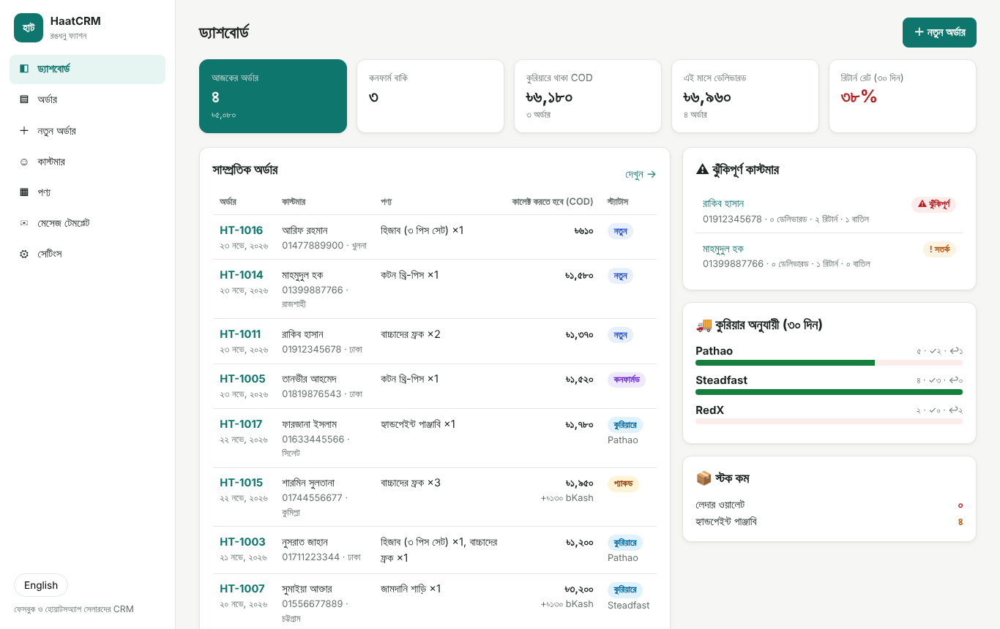

<div align="center">

# 🛍️ HaatCRM (হাট)

**বাংলাদেশের ফেসবুক, হোয়াটসঅ্যাপ ও ইনস্টাগ্রাম সেলারদের জন্য ওপেন সোর্স CRM**

*Open-source CRM built for Bangladesh's f-commerce sellers — orders, COD, couriers and fake-order protection, in Bangla.*

[বাংলা](#বাংলা) · [English](#english)



</div>

---

## বাংলা

### কেন HaatCRM?

বাংলাদেশে লাখো মানুষ ফেসবুক পেজ আর হোয়াটসঅ্যাপে ব্যবসা করেন। কিন্তু Salesforce, HubSpot বা Odoo-এর মতো CRM বানানো হয়েছে অন্য দেশের ব্যবসার জন্য — সেখানে না আছে ক্যাশ অন ডেলিভারি, না আছে bKash, না আছে Pathao/Steadfast, না আছে বাংলা। তাই বেশিরভাগ সেলার এখনো খাতা, Excel আর মেসেঞ্জারের স্ক্রিনশটে অর্ডার সামলান।

HaatCRM বানানো হয়েছে ঠিক এই সেলারদের রোজকার কাজের জন্য।

### ফিচার

| | |
|---|---|
| 📋 **মেসেজ পেস্ট করে অর্ডার** | কাস্টমারের মেসেঞ্জার/হোয়াটসঅ্যাপ মেসেজ পেস্ট করুন — নাম, মোবাইল, ঠিকানা, জেলা, পরিমাণ, bKash TrxID নিজে থেকেই ফর্মে বসে যাবে। বাংলা সংখ্যা (০১৭...), +৮৮০, এক লাইনে বা আলাদা লাইনে — সব চলে। |
| ⚠️ **ফেক অর্ডার / রিটার্ন রিস্ক স্কোর** | মোবাইল নম্বর লেখার সাথে সাথে দেখাবে এই কাস্টমার আগে কতবার রিটার্ন বা বাতিল করেছে, আর পরামর্শ দেবে: সরাসরি পাঠান, কল করে নিন, ডেলিভারি চার্জ অগ্রিম নিন, নাকি পুরো টাকা অগ্রিম। |
| 💵 **COD হিসাব** | সাবটোটাল − ডিসকাউন্ট + ডেলিভারি চার্জ − অগ্রিম = কত টাকা কালেক্ট করতে হবে। কুরিয়ারে কত টাকা আটকে আছে ড্যাশবোর্ডে দেখা যায়। |
| 🚚 **কুরিয়ার ট্র্যাকিং** | Pathao, Steadfast, RedX, Paperfly, Sundarban, eCourier। ট্র্যাকিং আইডি দিলেই অর্ডার "কুরিয়ারে" চলে যায়, এক ক্লিকে ট্র্যাক করা যায়। কোন কুরিয়ারে রিটার্ন বেশি, সেটাও দেখা যায়। |
| 🗺️ **৬৪ জেলা** | ঠিকানা থেকে জেলা চিনে নেয় (বাংলা, ইংরেজি, পুরনো বানান — Chittagong/Comilla/Bogra), ঢাকার ভিতরে না বাইরে বুঝে ডেলিভারি চার্জ বসায়। |
| 💬 **রেডি মেসেজ** | কনফার্মেশন, শিপিং, অগ্রিম চাওয়া, ধন্যবাদ — টেমপ্লেট থেকে এক ক্লিকে কপি বা সরাসরি WhatsApp-এ পাঠান। |
| 🖨️ **ইনভয়েস ও পার্সেল লেবেল** | প্রিন্ট করে পার্সেলে লাগানোর লেবেলসহ। |
| 📦 **স্টক** | অর্ডার দিলে স্টক কমে, বাতিল/রিটার্ন হলে ফেরত আসে। স্টক কম হলে সতর্ক করে। |
| 📱 **মোবাইলে চলে** | বেশিরভাগ সেলার ফোনে কাজ করেন — তাই নিচে নেভিগেশন বার, বড় বাটন। |
| 🇧🇩 **বাংলা ও ইংরেজি** | এক ক্লিকে ভাষা বদল। সংখ্যা বাংলায় (৳১,২৫০)। |
| 🔒 **আপনার ডাটা আপনার কাছে** | কোনো ক্লাউড নেই, সাবস্ক্রিপশন নেই। সব ডাটা একটা ফাইলে (`data/haat.db`) — কপি করলেই ব্যাকআপ। |
| ⬇️ **CSV এক্সপোর্ট** | অর্ডার ও কাস্টমার Excel-এ খোলার মতো CSV (বাংলা ঠিকমতো দেখায়)। |

### চালু করার নিয়ম

শুধু [Node.js](https://nodejs.org) ২০ বা তার পরের ভার্সন লাগবে।

```bash
git clone https://github.com/barshon-ex/haatcrm.git
cd haatcrm
npm install
npm run seed      # (ঐচ্ছিক) ডেমো ডাটা দিয়ে দেখতে চাইলে
npm run build
npm start
```

এবার ব্রাউজারে খুলুন: **http://localhost:3000**

ডেমো ডাটা মুছে নতুন করে শুরু করতে: `data/haat.db` ফাইলটা ডিলিট করে দিন।

#### Docker দিয়ে

```bash
docker compose up -d
```

#### ফোন থেকে ব্যবহার

একই ওয়াইফাইতে থাকলে ফোনের ব্রাউজারে `http://কম্পিউটারের-IP:3000` খুলুন। অনলাইনে রাখতে চাইলে যেকোনো VPS (DigitalOcean, Hetzner, বা দেশি হোস্টিং)-এ Docker দিয়ে চালান।

> ⚠️ এই ভার্সনে লগইন নেই। ইন্টারনেটে খোলা রাখলে সামনে একটা পাসওয়ার্ড (যেমন Nginx basic auth বা Cloudflare Access) দিয়ে রাখুন। লগইন ফিচার রোডম্যাপে আছে।

### রিস্ক স্কোর কীভাবে কাজ করে

প্রতিটা কাস্টমারের **আপনার দোকানে** আগের অর্ডার দেখে হিসাব হয়:

```
স্কোর = (রিটার্ন + ০.৫ × বাতিল) ÷ (মোট অর্ডার + ১) × ১০০
```

| লেভেল | কখন | পরামর্শ |
|---|---|---|
| ✦ নতুন | কোনো অর্ডার নেই | কল করে কনফার্ম করুন |
| ✓ নিরাপদ | স্কোর < ২৫ | সরাসরি পাঠান |
| ! সতর্ক | স্কোর ২৫–৫৯ | ডেলিভারি চার্জ অগ্রিম নিন |
| ⚠ ঝুঁকিপূর্ণ | স্কোর ≥ ৬০ বা ৩+ রিটার্ন | পুরো টাকা অগ্রিম ছাড়া পাঠাবেন না |

"+১" রাখা হয়েছে যাতে প্রথম অর্ডারেই একবার রিটার্ন করলে কাউকে সরাসরি "ফ্রড" বলা না হয়। কাউকে চাইলে হাতে ব্লকও করা যায়।

### রোডম্যাপ

- [ ] লগইন ও একাধিক স্টাফ (মডারেটর, প্যাকার)
- [ ] Steadfast / Pathao API দিয়ে সরাসরি পার্সেল বুকিং ও স্ট্যাটাস সিঙ্ক
- [ ] কমিউনিটি ফ্রড লিস্ট (সেলাররা নিজেদের মধ্যে রিটার্নকারী নম্বর শেয়ার করবে — ঐচ্ছিক)
- [ ] ফেসবুক পেজ ইনবক্স ইন্টিগ্রেশন
- [ ] SMS নোটিফিকেশন (বাংলাদেশি SMS গেটওয়ে)
- [ ] রিপোর্ট: প্রোডাক্ট অনুযায়ী লাভ, বিজ্ঞাপন খরচ
- [ ] PWA — ফোনে অ্যাপের মতো ইনস্টল

আপনার আইডিয়া থাকলে [Issue খুলুন](../../issues)।

### অবদান রাখুন

যেকোনো সাহায্য স্বাগতম — কোড, বানান ঠিক করা, নতুন কুরিয়ার, ডকুমেন্টেশন। বিস্তারিত: [CONTRIBUTING.md](CONTRIBUTING.md)

---

## English

### Why

Millions of people in Bangladesh sell through Facebook pages, WhatsApp and Instagram. Mainstream CRMs (Salesforce, HubSpot, Twenty, EspoCRM, Odoo) are built around email pipelines and B2B deals — none of them understand **cash-on-delivery, bKash/Nagad advances, local couriers, fake orders, or Bangla**. So most sellers still run their business on notebooks, Excel and Messenger screenshots.

HaatCRM is built specifically for that workflow.

### Features

- **Paste-to-order** — paste a customer's Messenger/WhatsApp message and the name, mobile, address, district, quantity, bKash/Nagad TrxID and advance amount are extracted automatically. Handles Bangla digits, `+880`, labeled or unlabeled lines, one-liners, Bangla/English/Banglish.
- **Fake-order / return risk score** — as soon as a phone number is typed you see that customer's delivered / returned / cancelled history in your shop and a recommendation (ship, call first, take delivery charge in advance, or full advance only). Customers can also be blocked.
- **COD-first money math** — subtotal − discount + delivery − advance = cash to collect. Dashboard shows how much COD is currently sitting with couriers.
- **Couriers** — Pathao, Steadfast, RedX, Paperfly, Sundarban, eCourier. Adding a tracking ID moves the order to *shipped*; tracking links; per-courier delivery vs return bars.
- **All 64 districts** — detects the district from an address (Bangla, English, legacy spellings like Chittagong/Comilla/Bogra and Dhaka neighbourhoods like Mirpur/Uttara), sets inside/outside-Dhaka delivery charge.
- **Message templates** — confirmation, shipped, advance request, thank-you; one-click copy or open in WhatsApp with the text pre-filled.
- **Printable invoice + parcel label**
- **Stock tracking** — reserved on order, released on cancel/return, low-stock alerts.
- **Mobile-first UI** with bottom navigation.
- **Bangla & English** UI with Bangla numerals.
- **Self-hosted, single-file database** (SQLite). No cloud, no subscription. Back up by copying `data/haat.db`.
- **CSV export** (UTF-8 with BOM so Excel shows Bangla correctly).

### Quick start

Requires Node.js 20+.

```bash
git clone https://github.com/barshon-ex/haatcrm.git
cd haatcrm
npm install
npm run seed     # optional demo data
npm run build && npm start
# open http://localhost:3000
```

Or with Docker: `docker compose up -d`

Set `HAAT_DB_PATH` to store the database elsewhere.

> ⚠️ v0.1 has no authentication. If you expose it to the internet, put it behind a password (Nginx basic auth, Cloudflare Access, Tailscale…). Auth is on the roadmap.

### Tech stack

- [Next.js](https://nextjs.org) (App Router, Server Actions) + React 19 + TypeScript
- SQLite via [better-sqlite3](https://github.com/WiseLibs/better-sqlite3)
- Zero UI framework — one hand-written CSS file
- [Vitest](https://vitest.dev) for tests

### Project layout

```
src/
  app/                 pages + server actions (actions.ts) + API routes (lookup, CSV export)
  components/          OrderForm (paste-to-order, live risk lookup), tables, badges
  lib/
    bd.ts              Bangla digits, BD phone numbers & operators, 64 districts, couriers, TrxID
    parser.ts          paste-to-order message parser
    risk.ts            fake-order / return risk score
    i18n.ts            Bangla + English dictionaries
    repo.ts            all database queries
    schema.sql         database schema
scripts/seed.mjs       demo data
tests/                 unit tests
```

### Development

```bash
npm run dev        # http://localhost:3000 with hot reload
npm test           # unit tests
npm run typecheck
```

### Contributing

PRs welcome — especially courier API integrations, better parsing of real-world messages, translations and UI polish. See [CONTRIBUTING.md](CONTRIBUTING.md).

### License

[MIT](LICENSE)
